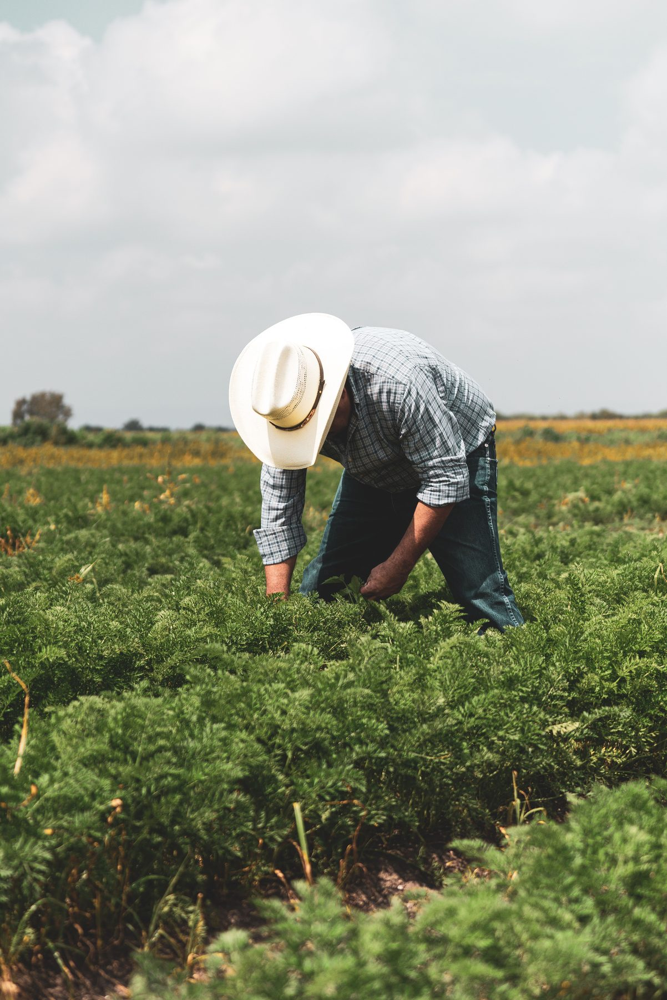

```{=html}
<a class="skip-link" href="#main">Skip to content</a>
<main id="main">
```

::::: {.gw-page .gw-section .gw-section--tight}
```{=html}
<p class="gw-eyebrow">Chapter 3 · Community Considerations</p>
<div class="gw-chapter-head gw-chapter-head--community">
```

```{=html}
<h1 class="gw-chapter-title">What data is needed, how is that data used, and in what ways is that work communicated to communities?</h1>
</div>
```

:::: gw-chapter-intro
::: gw-chapter-intro__body
::: gw-prose
Each question has its own answer in the documents. The data needed is mostly
domestic well records, and those records have gaps. All six basins use them to
test groundwater thresholds against well depths, by different methods.
Communication runs through Spanish-language materials and other products and
programs, which vary by basin.

The page also asks three equity questions: who is represented, who can
participate, and who bears the consequences. Across the
 subbasins, representative and
procedural equity vary independently. Distributional equity asks which
residents bear dewatering risk. It is the least reported. Every basin holds the well-completion records, published thresholds
and community boundaries for that analysis, though the well records have gaps
in location and construction.
:::
:::

```{=html}
<figure class="chapter-photo chapter-photo--community">
  <div class="chapter-photo__frame">
    
  </div>
  <figcaption class="chapter-photo__credit">Photo by Cristian Rojas on <a href="https://www.pexels.com/photo/10041309/" target="_blank" rel="noopener">Pexels</a>.</figcaption>
</figure>
```
::::
:::::

:::: {.gw-wide .gw-section #key-gaps}
```{=html}
<h2 class="gw-eyebrow">Key findings</h2>
<p class="gw-section-lede">Takeaways from both the desktop analysis and internal team discussions regarding which subbasin details were most relevant and pertinent.</p>
<div class="gw-gaps gw-loading" data-chapter="community">Loading the key findings&hellip;</div>
<script type="module" src="assets/js/key-gaps.js"></script>
```
::::

:::: {.gw-band #compare}
::: gw-wide
```{=html}
<h2 class="gw-eyebrow">Across the  subbasins</h2>
<p class="gw-section-lede">Topic by topic, how each subbasin handles representation, engagement, domestic wells, water quality and community-facing data. The cross-basin read comes first, with citations kept.</p>
<div class="gw-compare gw-loading" data-chapter="community">Loading the comparison&hellip;</div>
<script type="module" src="assets/js/synthesis.js"></script>
```
:::
::::

::: {.gw-page .gw-section .gw-section--tight .gw-cta}
```{=html}
<p>Claims on this page trace to coded findings and the cross-basin synthesis, with direct quotes and document locations.</p>
<a class="gw-btn" href="findings.html?chapter=3.%20Community%20Considerations">Explore the  community findings &rarr;</a>
```
:::

```{=html}
</main>
```
