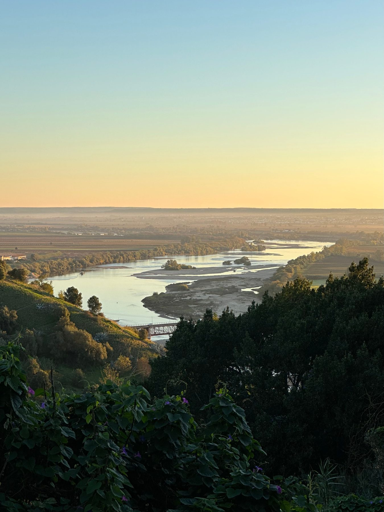

```{=html}
<a class="skip-link" href="#main">Skip to content</a>
<main id="main">
```

::::: {.gw-page .gw-section .gw-section--tight}
```{=html}
<p class="gw-eyebrow">Chapter 1 · Interconnected Surface Water</p>
<div class="gw-chapter-head gw-chapter-head--isw">
```

```{=html}
<h1 class="gw-chapter-title">How does a pumping impact become a management decision?</h1>
</div>
```

:::: gw-chapter-intro
::: gw-chapter-intro__body
::: gw-prose
Pumping groundwater near a stream depletes it — by drawing surface water
into the aquifer or by intercepting groundwater that would have fed the
stream. The effect is lagged and depends on aquifer properties that are
usually inferred rather than observed, which makes interconnected surface
water (ISW) one of the hardest quantities to account for under SGMA.

All  subbasins run a numerical
groundwater–surface water model, and none uses model output directly as
its compliance measure. Compliance runs instead on groundwater levels or
streamflow at monitoring sites — a proxy for the depletion itself.
:::
:::

```{=html}
<figure class="chapter-photo chapter-photo--water">
  <div class="chapter-photo__frame">
    
  </div>
</figure>
```
::::
:::::

:::: {.gw-band .gw-band--blue}
::: gw-wide
```{=html}
<h2 class="gw-eyebrow">The accounting chain</h2>
<p class="gw-section-lede">Seven steps connect a pumping well to a management decision. The chain holds through modelling — and breaks where compliance switches to a proxy.</p>

<section class="gw-steps-scene isw-scene" data-scroll-steps aria-label="The interconnected surface water accounting chain, step by step">
  <div class="gw-steps-scene__figure">
    <figure class="gw-figure isw-figwrap" data-follow>
      <p id="isw-plate-summary" class="gw-sr-summary">
            A shallow cutaway of a stream and the ground beneath it. A thick band
            of vegetation sits over a thicker band of brown sediment; below them
            is one continuous saturated aquifer. The boundary between the brown
            sediment and the blue aquifer is the water table. A broad, shallow
            stream sits in a low bowl on the left, and the water table meets it,
            so shallow groundwater and the stream are one connected system. A
            monitoring well stands beside the stream; a deeper pumping well
            stands away from it. Pumping pulls the water table down into a cone
            of depression and reduces the groundwater that would otherwise reach
            the stream; the gap from the pre-pumping water table is the stream
            depletion attributable to pumping. A model can estimate that
            depletion, but the compliance test runs instead on a groundwater
            level at the monitoring well — a proxy — checked against a
            threshold. That substitution is where the chain breaks.
          </p>

          <svg class="isw-svg" viewBox="0 0 648 430" role="img" aria-labelledby="isw-fig-title isw-plate-summary" xmlns="http://www.w3.org/2000/svg">
            <title id="isw-fig-title">Cutaway of pumping, the water table, and stream depletion</title>
            <defs>
              <clipPath id="isw-sect"><path d="M0 114 Q 34 109 66 113 Q 100 119 132 112 Q 146 109 156 100 Q 178 74 204 62 Q 270 54 350 57 Q 440 61 524 54 Q 582 50 624 55 L640 43 L640 414 L624 426 L0 426 Z"/></clipPath>
              <pattern id="isw-clast" width="50" height="42" patternUnits="userSpaceOnUse" patternTransform="rotate(5)">
                <path d="M9 11 q4 -5 8 -1 q3 4 -1 7 q-6 3 -9 -1 z" fill="#9c7a5552" />
                <path d="M30 5 q5 -2 7 3 q1 5 -4 7 q-6 0 -6 -5 z" fill="#89694650" />
                <path d="M41 25 q5 -1 6 4 q0 5 -5 6 q-5 -1 -5 -6 z" fill="#a8825b48" />
                <path d="M15 30 q4 -4 7 0 q3 4 -1 7 q-5 3 -8 -1 z" fill="#82623f52" />
                <circle cx="45" cy="10" r="2" fill="#9c7a5548" />
                <circle cx="4" cy="35" r="2.1" fill="#93714b44" />
                <circle cx="25" cy="33" r="1.5" fill="#a8825b40" />
              </pattern>
              <marker id="isw-ar" viewBox="0 0 10 10" refX="7" refY="5" markerWidth="6" markerHeight="6" orient="auto-start-reverse">
                <path d="M0 1 L8 5 L0 9 z" fill="#33454f" />
              </marker>
              <marker id="isw-arl" viewBox="0 0 10 10" refX="7" refY="5" markerWidth="5.5" markerHeight="5.5" orient="auto-start-reverse">
                <path d="M0 1 L8 5 L0 9 z" fill="#e3e9ec" />
              </marker>
              <marker id="isw-fb" viewBox="0 0 10 10" refX="6" refY="5" markerWidth="5" markerHeight="5" orient="auto-start-reverse">
                <path d="M0 1 L8 5 L0 9 z" fill="#6a6659" />
              </marker>
              <g id="isw-grass" fill="none" stroke-linecap="round">
                <path d="M0 0 Q -3 -11 -8 -18" stroke="#6f8a3c" stroke-width="1.8" />
                <path d="M0 0 Q 0 -12 -1 -21" stroke="#7d9846" stroke-width="1.8" />
                <path d="M0 0 Q 4 -11 9 -17" stroke="#6f8a3c" stroke-width="1.8" />
                <path d="M0 0 Q 7 -8 13 -12" stroke="#647c37" stroke-width="1.6" />
                <path d="M0 0 Q -6 -8 -12 -12" stroke="#647c37" stroke-width="1.6" />
              </g>
              <g id="isw-flower">
                <line x1="0" y1="1" x2="0" y2="10" stroke="#4a5c26" stroke-width="1.2" />
                <circle cx="0" cy="0" r="2.4" fill="#d8c667" />
                <circle cx="-2.6" cy="0" r="1.5" fill="#d8c667" />
                <circle cx="2.6" cy="0" r="1.5" fill="#d8c667" />
                <circle cx="0" cy="-2.6" r="1.5" fill="#d8c667" />
                <circle cx="0" cy="2.6" r="1.5" fill="#d8c667" />
                <circle cx="0" cy="0" r="1.1" fill="#b99a3f" />
              </g>
            </defs>

            <!-- ================= FIXED GEOLOGY — FRONT FACE ================= -->
            <g clip-path="url(#isw-sect)">
              <rect x="-4" y="38" width="656" height="392" fill="#5c7080" />
              <rect x="-4" y="38" width="656" height="392" fill="url(#isw-clast)" />
              <rect x="-4" y="52" width="656" height="244" fill="#5b3f28" />
              <rect x="-4" y="52" width="656" height="244" fill="url(#isw-clast)" />
              <!-- blue saturated aquifer; its TOP EDGE is the water table -->
              <path d="M-4 430 L-4 132 C 30 128 70 122 110 124 C 180 128 250 150 326 172 C 366 182 392 190 410 202 C 430 220 468 220 488 202 C 510 190 552 182 592 182 L624 192 L624 430 Z" fill="#5c7080" />
              <path d="M-4 430 L-4 132 C 30 128 70 122 110 124 C 180 128 250 150 326 172 C 366 182 392 190 410 202 C 430 220 468 220 488 202 C 510 190 552 182 592 182 L624 192 L624 430 Z" fill="url(#isw-clast)" />
              <!-- water-table / sediment-base line: one boundary, on the colour change -->
              <path d="M108 124 C 180 128 250 150 326 172 C 366 182 392 190 410 202 C 430 220 468 220 488 202 C 510 190 552 182 592 182 L624 192" fill="none" stroke="#39281880" stroke-width="1.7" />
              <!-- vegetation -->
              <path d="M150 100 Q 178 74 204 62 Q 270 54 350 57 Q 440 61 524 54 Q 582 50 624 55 L624 98 Q 500 96 360 98 Q 250 100 172 104 Q 158 105 150 100 Z" fill="#3f5020" />
              <path d="M150 100 Q 250 100 360 98 Q 500 96 624 98" fill="none" stroke="#26310fcc" stroke-width="1.6" />
            </g>

            <!-- ================= 2.5D DEPTH — RIGHT SIDE FACE ================= -->
            <path d="M624 55 L640 43 L640 414 L624 426 Z" fill="#4a5b68" />
            <path d="M624 55 L640 43 L640 414 L624 426 Z" fill="url(#isw-clast)" opacity="0.45" />
            <path d="M624 98 L640 86 L640 180 L624 192 Z" fill="#48311f" />
            <path d="M624 98 L640 86 L640 180 L624 192 Z" fill="url(#isw-clast)" opacity="0.45" />
            <path d="M624 55 L640 43 L640 86 L624 98 Z" fill="#313f19" />
            <path d="M470 52 L486 40 L640 43 L624 55 Z" fill="#43571f" />
            <path d="M624 55 L640 43" stroke="#242f0e" stroke-width="1.4" />
            <path d="M624 98 L640 86" stroke="#241810" stroke-width="1.4" />
            <path d="M624 192 L640 180" stroke="#2e3c46" stroke-width="1.4" />
            <path d="M624 55 L624 426" stroke="#2e2e22" stroke-width="1" opacity="0.28" />
            <path d="M624 426 L640 414" stroke="#2e3c46" stroke-width="1.4" />

            <!-- ================= MODEL DOMAIN (step 03) ================= -->
            <g class="fig-stage fig-stage--model">
              <rect x="-4" y="188" width="628" height="238" fill="#33697f" opacity="0.13" />
            </g>

            <!-- ================= SURFACE WATER (broad, shallow, left depth face) ================= -->
            <path d="M0 116 L6 112 L6 138 L0 143 Z" fill="#5e7686" />
            <path d="M6 112 Q 30 107 58 112 Q 90 118 120 111 Q 138 108 150 115 Q 150 129 137 137 Q 96 150 54 148 Q 24 146 8 135 Q 6 124 6 112 Z" fill="#7c96a8" />
            <path d="M10 132 Q 52 149 100 146 Q 132 144 148 130 Q 140 148 96 152 Q 48 154 16 141 Z" fill="#5e7686" opacity="0.5" />
            <path d="M6 112 Q 30 107 58 112 Q 90 118 120 111 Q 138 108 150 115" fill="none" stroke="#57707e" stroke-width="1.3" />
            <path d="M0 116 L6 112" stroke="#4c6270" stroke-width="1.1" />

            <!-- ================= VEGETATION DETAIL ================= -->
            <g class="isw-flora">
              <use href="#isw-grass" transform="translate(246 56)" />
              <use href="#isw-grass" transform="translate(286 53) scale(0.85)" />
              <use href="#isw-grass" transform="translate(330 55)" />
              <use href="#isw-grass" transform="translate(392 52) scale(1.1)" />
              <use href="#isw-grass" transform="translate(500 51)" />
              <use href="#isw-grass" transform="translate(560 55) scale(0.9)" />
              <use href="#isw-flower" transform="translate(190 60)" />
              <use href="#isw-flower" transform="translate(304 50)" />
              <use href="#isw-flower" transform="translate(360 54) scale(0.9)" />
              <use href="#isw-flower" transform="translate(476 48)" />
              <use href="#isw-flower" transform="translate(596 55) scale(0.85)" />
            </g>

            <!-- ================= ATTRIBUTION (step 04) ================= -->
            <g class="fig-stage fig-stage--attribution">
              <path d="M108 124 C 180 128 250 150 326 172 C 366 182 392 190 410 202 C 430 220 468 220 488 202 C 510 190 552 182 592 182 L624 192 L624 190 C 560 186 470 196 380 178 C 280 156 180 128 108 124 Z" fill="#8a5b3a" opacity="0.28" />
              <path d="M108 124 C 200 130 300 158 380 178 C 470 196 560 186 624 190" fill="none" stroke="#26313a" stroke-width="1.3" stroke-dasharray="4 4" opacity="0.5" />
              <text x="300" y="196" font-size="11.5" font-style="italic" fill="#8a5638">pumping-attributable depletion</text>
            </g>

            <!-- ================= HYDROLOGIC RESPONSE (step 02) ================= -->
            <g class="fig-stage fig-stage--response">
              <path d="M108 124 C 180 128 250 150 326 172 C 366 182 392 190 410 202 C 430 220 468 220 488 202 C 510 190 552 182 592 182 L624 192" fill="none" stroke="#182a34" stroke-width="2.4" />
              <g stroke="#33454f" stroke-width="1.9" marker-end="url(#isw-ar)">
                <line x1="176" y1="140" x2="140" y2="132" />
                <line x1="182" y1="156" x2="146" y2="148" />
              </g>
              <g stroke="#e3e9ec" stroke-width="1.7" opacity="0.82" marker-end="url(#isw-arl)">
                <line x1="566" y1="322" x2="480" y2="316" />
                <line x1="400" y1="306" x2="316" y2="300" />
              </g>
            </g>

            <!-- ================= PUMPING WELL (step 01) ================= -->
            <g class="fig-stage fig-stage--pumping">
              <rect x="438" y="30" width="24" height="12" fill="#8a959b" />
              <rect x="448" y="22" width="6" height="9" fill="#8a959b" />
              <rect x="440" y="42" width="20" height="262" fill="#a7aeb2" />
              <rect x="444" y="42" width="9" height="262" fill="#c9cdcf" />
              <ellipse cx="450" cy="42" rx="10" ry="3" fill="#b7bec1" />
              <rect x="440" y="252" width="20" height="48" fill="none" stroke="#7a8288" stroke-width="1.1" stroke-dasharray="2 3" />
              <rect x="442" y="226" width="16" height="74" fill="#6f8ea0" opacity="0.92" />
              <ellipse cx="450" cy="226" rx="8" ry="2.4" fill="#8aa3b2" />
              <text x="450" y="34" font-size="13.5" text-anchor="middle" fill="#2c2b1c">Pumping well</text>
            </g>

            <!-- ================= MONITORING WELL (steps 05 &amp; 06) ================= -->
            <g class="fig-stage fig-stage--threshold fig-stage--compliance">
              <rect x="211" y="50" width="18" height="6" fill="#8a959b" />
              <rect x="213" y="56" width="14" height="122" fill="#a7aeb2" />
              <rect x="216" y="56" width="7" height="122" fill="#c9cdcf" />
              <ellipse cx="220" cy="56" rx="7" ry="2.4" fill="#b7bec1" />
              <rect x="213" y="140" width="14" height="38" fill="none" stroke="#7a8288" stroke-width="1.1" stroke-dasharray="2 3" />
              <rect x="215" y="146" width="10" height="32" fill="#6f8ea0" opacity="0.92" />
              <ellipse cx="220" cy="146" rx="5" ry="1.8" fill="#8aa3b2" />
              <text x="220" y="42" font-size="13.5" text-anchor="middle" fill="#2c2b1c">Monitoring well</text>
              <line x1="229" y1="146" x2="246" y2="146" stroke="#845c3e" stroke-width="1.8" />
              <path d="M249 141 l8 5 l-8 5 z" fill="#845c3e" />
            </g>

            <!-- ================= MANAGEMENT RESPONSE (step 07) ================= -->
            <g class="fig-stage fig-stage--management">
              <path d="M232 44 C 300 4 402 4 452 26" fill="none" stroke="#6a6659" stroke-width="1.3" stroke-dasharray="2 5" opacity="0.5" marker-end="url(#isw-fb)" />
              <text x="332" y="8" font-size="11" text-anchor="middle" fill="#6a6659" opacity="0.72">weak feedback</text>
            </g>

            <!-- ================= LABELS ================= -->
            <text x="6" y="102" font-size="14" fill="#20303a">Surface water</text>
            <text x="256" y="140" font-size="13" font-style="italic" fill="#eef2f4">Water table</text>
            <text x="252" y="352" font-size="15" fill="#e9eff2">Saturated aquifer</text>
          </svg>
    </figure>
    <p class="isw-phase" aria-hidden="true"><span data-for="physical">Physical response</span><span data-for="accounting">Accounting chain</span></p>
  </div>

  <ol class="gw-steps-scene__steps">
    <li class="gw-step" data-step="pumping" data-phase="physical">
      <span class="gw-step__n">01</span>
      <h3 class="gw-step__t">Pumping</h3>
      <p>Wells pump at different depths. Models see averaged demand spread across grid cells, not individual wells.</p>
    </li>
    <li class="gw-step" data-step="response" data-phase="physical">
      <span class="gw-step__n">02</span>
      <h3 class="gw-step__t">Hydrologic response</h3>
      <p>The water table falls and less groundwater reaches the stream — lagged, attenuated, and mixed with every other driver of streamflow.</p>
    </li>
    <li class="gw-step" data-step="model" data-phase="accounting">
      <span class="gw-step__n">03</span>
      <h3 class="gw-step__t">Measurement &amp; model</h3>
      <p>Every basin runs a numerical model. Three report a pumping-attributable estimate; three report net stream–aquifer exchange from all causes and call it depletion.</p>
    </li>
    <li class="gw-step" data-step="attribution" data-phase="accounting">
      <span class="gw-step__n">04</span>
      <h3 class="gw-step__t">Attribution</h3>
      <p>Runs with and without pumping isolate pumping's share — at basin, reach or zone scale. No basin attributes depletion to individual wells.</p>
    </li>
    <li class="gw-step gw-step--break" data-step="break" data-phase="accounting">
      <span class="gw-step__n">✕</span>
      <h3 class="gw-step__t">The chain breaks</h3>
      <p>Modelled depletion stops here. Compliance switches to a groundwater-level or streamflow proxy, and no basin sets a threshold on a depletion volume.</p>
    </li>
    <li class="gw-step" data-step="threshold" data-phase="accounting">
      <span class="gw-step__n">05</span>
      <h3 class="gw-step__t">Sustainability threshold</h3>
      <p>Five basins set ISW thresholds on groundwater elevations, mostly anchored to a recent drought; Kaweah sets a flow criterion on one reach.</p>
    </li>
    <li class="gw-step" data-step="compliance" data-phase="accounting">
      <span class="gw-step__n">06</span>
      <h3 class="gw-step__t">Accounting &amp; compliance</h3>
      <p>The compliance test runs on that proxy. By the agencies' own account, it cannot separate a pumping effect from a dry year or reservoir operations.</p>
    </li>
    <li class="gw-step" data-step="management" data-phase="accounting">
      <span class="gw-step__n">07</span>
      <h3 class="gw-step__t">Management response</h3>
      <p>Where undesirable results were declared — East Turlock and Salinas Valley — no management consequence followed. The loop back to pumping stays weak.</p>
    </li>
  </ol>
</section>
<script type="module" src="assets/js/scroll-steps.js"></script>
```
:::
::::

:::: {.gw-wide .gw-section #key-gaps}
```{=html}
<h2 class="gw-eyebrow">Key gaps</h2>
<p class="gw-section-lede">Where the reviewed plans, the literature, and the accounting fall short of one another — the central takeaways of this chapter.</p>
<div class="gw-gaps gw-loading" data-chapter="isw">Loading the key gaps&hellip;</div>
<script type="module" src="assets/js/key-gaps.js"></script>
```
::::

:::: {.gw-band #compare}
::: gw-wide
```{=html}
<h2 class="gw-eyebrow">Across the  subbasins</h2>
<p class="gw-section-lede">Topic by topic, how each subbasin's documents handle interconnected surface water — with the cross-basin read first and the citations kept.</p>
<div class="gw-compare gw-loading" data-chapter="isw">Loading the comparison&hellip;</div>
<script type="module" src="assets/js/synthesis.js"></script>
```
:::
::::

::: {.gw-page .gw-section .gw-section--tight .gw-cta}
```{=html}
<p>Every claim on this page traces to coded findings with direct quotes and document locations.</p>
<a class="gw-btn" href="findings.html?chapter=1.%20ISW">Explore the  ISW findings &rarr;</a>
```
:::

```{=html}
</main>
```
