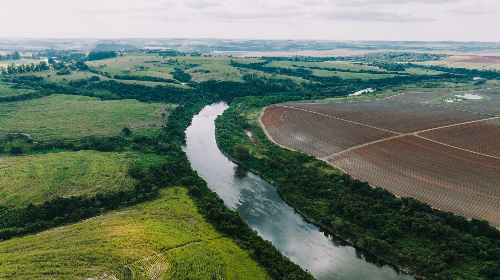

```{=html}
<a class="skip-link" href="#main">Skip to content</a>
<main id="main">
```

::::: {.gw-page .gw-section .gw-section--tight}
```{=html}
<p class="gw-eyebrow">Chapter 2 · Multi-benefit Land Repurposing</p>
<div class="gw-chapter-head gw-chapter-head--mlrp">
```

```{=html}
<h1 class="gw-chapter-title">When land is repurposed, what is actually measured?</h1>
</div>
```

:::: gw-chapter-intro
::: gw-chapter-intro__body
::: gw-prose
Multi-benefit land repurposing (MLRP) treats farmland facing reduced water
availability under SGMA as an opportunity to deliver habitat, community and
economic benefits alongside water savings, rather than leaving it to fallow
unplanned. Each of those benefits implies a measurement. This chapter asks
which measurements are made, when, and whether they feed the accounting
system.

Four of the  subbasins are covered by a
Department of Conservation MLRP block grant of \$8.89–10 million. They differ
most in when they count water — after implementation, before it, or not as a
separate figure at all — and none measures a delivered outcome for the
co-benefits it names. Colusa and Yolo hold no MLRP grant; their
repurposing-type activity runs through other programs and partners.
:::
:::

```{=html}
<figure class="chapter-photo chapter-photo--land">
  <div class="chapter-photo__frame">
    
  </div>
</figure>
```
::::
:::::

:::: {.gw-band .gw-band--sage}
::: gw-wide
```{=html}
<h2 class="gw-eyebrow">Beyond water savings</h2>
<p class="gw-section-lede">How far does quantification reach for each benefit a repurposing program claims? The literature quantifies most of them. In the grantee subbasins, most stop at naming or scoring a benefit before the project is built.</p>

<div id="mlrp-matrix" class="gw-mx gw-loading">Loading the co-benefits matrix&hellip;</div>
<script type="module" src="assets/js/mlrp-matrix.js"></script>

<p class="gw-caption">Measurement states are the analyst's ordinal scale — how far quantification reaches — not a score of program quality. "Not found" means not found in the reviewed documents, not that the practice does not exist. Colusa and Yolo hold no MLRP grant and are not rated; their programs are compared under topic 2.10 below.</p>
```
:::
::::

:::: {.gw-wide .gw-section #key-gaps}
```{=html}
<h2 class="gw-eyebrow">Key gaps</h2>
<p class="gw-section-lede">Where repurposing programs, the literature, and the accounting fall short of one another — the central takeaways of this chapter.</p>
<div class="gw-gaps gw-loading" data-chapter="mlrp">Loading the key gaps&hellip;</div>
<script type="module" src="assets/js/key-gaps.js"></script>
```
::::

:::: {.gw-band #compare}
::: gw-wide
```{=html}
<h2 class="gw-eyebrow">Across the  subbasins</h2>
<p class="gw-section-lede">Topic by topic, how each subbasin finances, verifies, credits and monitors land repurposing — with the cross-basin read first and the citations kept.</p>
<div class="gw-compare gw-loading" data-chapter="mlrp">Loading the comparison&hellip;</div>
<script type="module" src="assets/js/synthesis.js"></script>
```
:::
::::

::: {.gw-page .gw-section .gw-section--tight .gw-cta}
```{=html}
<p>Every claim on this page traces to coded findings with direct quotes and document locations.</p>
<a class="gw-btn" href="findings.html?chapter=2.%20MLRP">Explore the  land repurposing findings &rarr;</a>
```
:::

```{=html}
</main>
```
